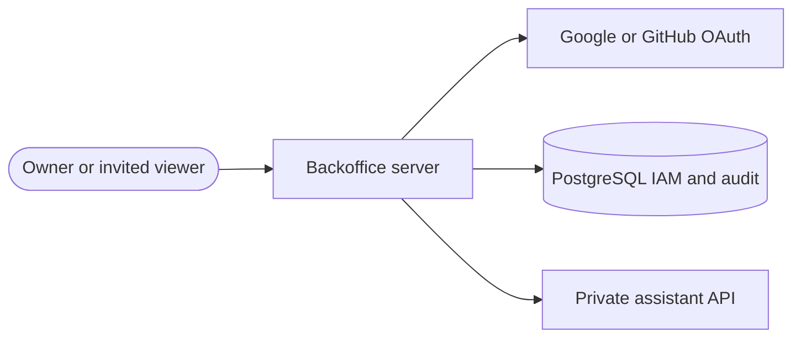

<!-- Variant: PUBLIC -->
<div align="center">
  <h1>Portfolio Backoffice</h1>
  <p>Private operations console for the portfolio website and its assistant: invited access, health, usage and site activity.</p>
  <a href="https://github.com/gonzalomartinperez/portfolio-backoffice/actions/workflows/ci.yml"></a>
  <a href="https://github.com/gonzalomartinperez/portfolio-backoffice/releases"></a>
  <a href="LICENSE"></a>
</div>


## Why

The portfolio's public assistant lives in the [portfolio](https://github.com/gonzalomartinperez/portfolio)
site and its [API](https://github.com/gonzalomartinperez/portfolio-assistant-api). The owner still
needs to know whether the assistant is healthy, how fresh its knowledge is, what it costs and how
visitors use the site, without exposing prompts, answers, credentials or visitor identities. This
application is that private view. Access is Google or GitHub sign-in for the verified owner and
invited viewers only. Every page, action and API checks live membership on the server. Missing
metrics read as unavailable, never as zero, and fixture data is always labelled synthetic.

## Highlights

- Invitation-only OAuth (Google, GitHub) with explicit account linking, atomic invitations, live
  revocation and an append-only audit trail in PostgreSQL ([authentication](docs/explanation/authentication.md)).
- Operations overview: availability, knowledge freshness, 30-day executions, first-token latency,
  sampled stage timings, UTC-month usage and budget headroom, and answer feedback.
- Optional website-interaction reports over bounded daily aggregates, off by default
  ([product analytics](docs/explanation/product-analytics.md)).
- Bilingual US English and Latin American Spanish (`es-419`), dark and light themes, and WCAG 2.2 AA
  checked with axe on every route, state, theme and locale.
- Strict security headers, contract snapshots pinned by SHA-256, and service tokens that never reach
  the browser ([deployment contract](docs/reference/deployment-contract.md)).
- One required CI aggregate (`ci-gate`) over the profiles in [CI reference](docs/reference/ci.md).

## Architecture



Dependencies point inward: domain and application code are framework-free, adapters validate every
upstream payload at runtime, and only server composition holds service tokens. Trust boundaries and
diagram sources: [docs/explanation/architecture.md](docs/explanation/architecture.md).

## Quickstart

```bash
nvm use && npm ci            # Node from .nvmrc, frozen install
npm run check                # format, lint, types, unit and contract tests, docs, licences, skills, secrets
npm run test:browser         # production build against an isolated fixture database (see First run)
```

Requirements: Node 24 LTS (`.nvmrc`), Docker for the disposable PostgreSQL used by the integration
and browser suites. The [First run](docs/tutorials/first-run.md) tutorial covers development OAuth
applications, the credential-free fixture preview and the runtime image.

## Usage

Where it runs: on the owner's VPS, deployed by the private `vps-ops` repository after separate
authorization ([deployment contract](docs/reference/deployment-contract.md)). Locally, the fixture
preview serves synthetic data with signed fixture sessions.

| Route | Question it answers |
|---|---|
| `/` | Is the assistant up, fresh and within budget, and what do visitors think of its answers? |
| `/analytics` | How do visitors use the site, by UTC day, week or month? |
| `/access` | Who can sign in? Invite, link and revoke (owner only). |
| `/privacy` | What does the backoffice store about the people who sign in? |

## Quality

| Gate | Tool | Threshold |
|---|---|---|
| Required check | `ci-gate` over the shared CI profiles | green on every PR |
| Lint, format and types | Biome, TypeScript 7 strict | zero findings |
| Unit and diff coverage | Vitest | floors in `quality/ratchets/coverage.json`; changed lines 80 %, auth and data access 90 % |
| Database | Testcontainers PostgreSQL 18 | IAM, grants and audit integration suite passes |
| Browser and accessibility | Playwright, axe-core | journeys, visual baseline and WCAG 2.2 AA with 0 violations |
| Mutation | Stryker | floor in `quality/ratchets/mutation.json` |
| Performance | Lighthouse (median of 5) and script bytes | budgets in `quality/ratchets/` |
| Image | structure test, dockle, Grype, SBOM | no fixable High or Critical findings |

Scores: [scorecard](docs/master-plan/scorecard.md); latest results: the
[CI workflow](https://github.com/gonzalomartinperez/portfolio-backoffice/actions/workflows/ci.yml).

## Documentation

[Tutorials](docs/tutorials/first-run.md) · [How-to](docs/how-to/) · [Reference](docs/reference/) ·
[Explanation](docs/explanation/) ([ADRs](docs/decisions/)) · [Master plan](docs/master-plan/README.md).
The full map is in [docs/README.md](docs/README.md).

## Ecosystem

| Repository | Role |
|---|---|
| [portfolio](https://github.com/gonzalomartinperez/portfolio) | Public bilingual portfolio site |
| [portfolio-assistant-api](https://github.com/gonzalomartinperez/portfolio-assistant-api) | Portfolio assistant API (RAG, evals) |
| [portfolio-backoffice](https://github.com/gonzalomartinperez/portfolio-backoffice) | Portfolio backoffice (IAM, operations) |
| [pequeverso](https://github.com/gonzalomartinperez/pequeverso) | Pequeverso public store site |
| [pequeverso-assistant-api](https://github.com/gonzalomartinperez/pequeverso-assistant-api) | Pequeverso shopping assistant API |
| [pequeverso-backoffice](https://github.com/gonzalomartinperez/pequeverso-backoffice) | Pequeverso backoffice (IAM, operations) |
| vps-ops (private) | Operations CLI and deploy contract |

## Contributing and security

See [CONTRIBUTING.md](CONTRIBUTING.md), [SECURITY.md](SECURITY.md), [SUPPORT.md](SUPPORT.md) and
[CODE_OF_CONDUCT.md](CODE_OF_CONDUCT.md). Agents follow [AGENTS.md](AGENTS.md).

## Scope and limits

- No public chat, no visitor tracking beyond bounded aggregates, and no prompts, answers or provider keys.
- Usage figures are estimates from configured prices, not a provider invoice.
- CI evidence uses synthetic data and an isolated database; it does not prove live OAuth, TLS or production capacity.
- Nothing is deployed or published without the owner's explicit authorization.

## License

Software: [MIT](LICENSE). Fonts, identity assets and external code keep their own
[attribution and terms](THIRD_PARTY_NOTICES.md).
