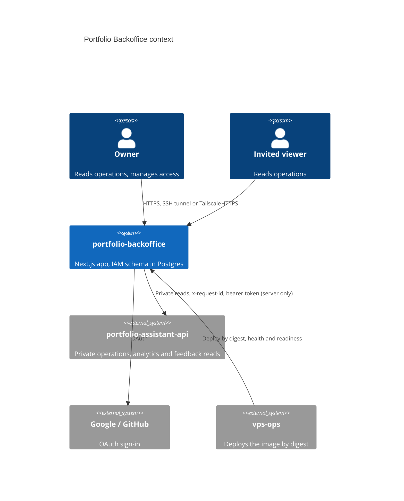
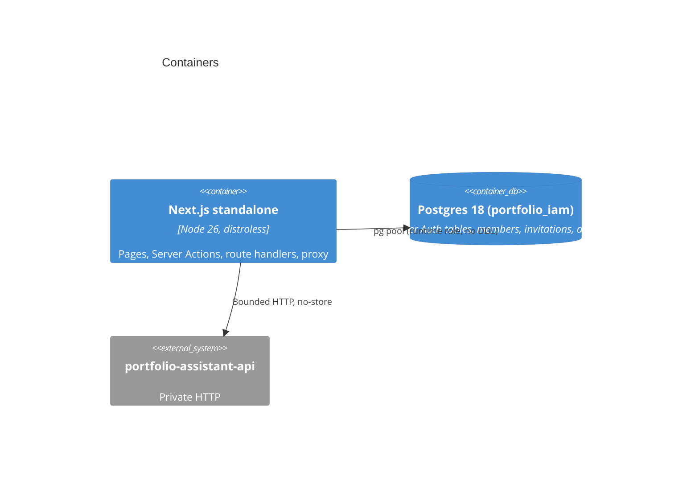

# Target state

Applies ecosystem sections 9 (backoffice architecture), 10.1 (TypeScript) and 13 (design) to this repository. File-by-file destinations are in [file-index.csv](file-index.csv); moves and deletions with motives are in [file-moves.md](file-moves.md). Decisions: PBO-D3, D4, D5, D6, D12, D13 in [README.md](README.md).

## 1. Principles

1. The dependency rule is mandatory and enforced by a guard with negative fixtures and an empty violation baseline (rubric D1). The number of layers depends on the code: a layer that only forwards calls is omitted (O3).
2. Authorization lives in the Data Access Layer (DAL), not in `proxy.ts`. The proxy only sets headers, creates `x-request-id` and does optimistic redirects (Next.js data-security guidance, research 01).
3. Server Components by default; `"use client"` only for interactive islands from an allowlist. Only validated, allowlisted DTOs cross the boundary.
4. "Unavailable, never zero" is a type: `Metric<T>` is a tagged union (`ok | empty | unavailable | stale | withheld`), so a missing value cannot be coerced to 0 by the chart or table API.
5. No cross-repository import: contracts are snapshots with revision and SHA-256 (invariant 1). The backoffice never receives a visitor transcript (invariant 2) and holds no provider key (invariant 3).
6. Keep what works: feature slices, bounded HTTP adapters, Better Auth admission hooks, transactional invitations.

## 2. C4 context and container





## 3. Target structure

```text
src/
  instrumentation.ts                   # OTel registration, off unless endpoint set
  proxy.ts                             # nonce CSP, HSTS, x-request-id, optimistic redirects only
  app/
    layout.tsx  globals.css  fonts.ts  icon.tsx  apple-icon.tsx
    global-error.tsx  not-found.tsx
    (auth)/sign-in/page.tsx            # own layout: monogram, constellation backdrop
    (shell)/layout.tsx                 # AppShell: StatusStrip, Sidebar, Topbar
    (shell)/loading.tsx  (shell)/error.tsx
    (shell)/page.tsx                   # Overview
    (shell)/runs/page.tsx  runs/[id]/page.tsx
    (shell)/usage/page.tsx
    (shell)/analytics/page.tsx         # Audience
    (shell)/feedback/page.tsx
    (shell)/access/page.tsx  access/audit/page.tsx
    (shell)/account/page.tsx
    privacy/page.tsx
    access/invitation/route.ts
    api/{auth/[...all],health,ready,operations}/route.ts
  design/
    tokens/structure.tokens.json       # shared structure (from the kit)
    tokens/pack-instrument.tokens.json # identity: primitives and light/dark mapping
    theme.css                          # generated, committed, snapshot-tested
  server/                              # server-only
    env.ts                             # the only reader of process.env; fails at boot
    container.ts                       # composition root (factories, process singletons)
    log.ts                             # JSON logger with field allowlist
    request-context.ts                 # request id, locale, theme, density per request
    dal/                               # authorization enforced here
      session.ts  authorize.ts
      overview.ts  runs.ts  usage.ts  audience.ts  feedback.ts  access.ts  audit.ts
    auth/{config,runtime,actions}.ts
  features/
    operations/ {domain,application,adapters,presentation}
    analytics/  {domain,application,adapters,presentation}   # Audience
    feedback/   {domain,application,adapters,presentation}
    auth/       {domain,application,adapters,presentation} entry.tsx
    audit/      {domain,application,adapters,presentation}   # new
  shared/
    ui/         # CVA primitives (inventory in design-playbook.md)
    dataviz/    # ChartFrame, ProportionBar, BulletBar, Sparkline, Heatmap, Waterfall, HBarList
    shell/      # AppShell parts, CommandPalette, RangePicker, UserMenu, SkipLink
    format/     # memoized Intl, UTC rules, units
    i18n/       # locale negotiation, typed dictionaries (en-US, es-419)
    http/       # bounded JSON, read-json
contracts/assistant-api/               # four consumed snapshots + manifest.json (revision, sha256)
migrations/                            # 0001..; scripts/migrate.ts runner
quality/ratchets/                      # committed ratchet JSON
tests/{unit,component,integration,e2e,fixtures}/
```

Notes: the shell route group `(shell)` keeps one layout for authenticated views; `(auth)` and `privacy` stay outside. `/__kit` (component state gallery) exists only when `NODE_ENV !== "production"` and under the test server, and is excluded from the production build by a guard.

## 4. Layers

| Layer | Contains | Rules |
|---|---|---|
| `domain` | Pure types, invariants, calculations (permission lattice, `classifyHealth(snapshot, now)`, budget status, report shaping, `Metric<T>`) | No I/O, no `Date.now()` (clock passed in), no framework import |
| `application` | Use cases with explicit ports where a fake exists in tests: `getOverview`, `listRuns`, `getRun`, `getUsage`, `getAudienceReport`, `listAccess`, `inviteViewer`, `revokeAccess`, `recordAudit`, `listAudit` | Depends only on `domain` and its own ports |
| `adapters` | Bounded HTTP readers, Ajv validators and mappers (`adapters/contract/*.validator.ts`), pg stores (`membership`, `invitation`, `session`, `audit`), Better Auth wiring | Implements ports; no presentation import (G4) |
| `presentation` | Props to UI, no `process.env`, no fetch, files at most 200 lines (ratchet) | No other feature's presentation (G3) |
| `server/dal` | One function per view or mutation: `requireSession()` then `authorize(permission, resource)` then use case | The only entry used by pages, actions and route handlers |
| `server/container.ts` | Builds adapters from `env.ts`, exposes use cases | Only place that instantiates adapters (G2) |

Ceremony omitted: no repository interface without a test fake, no DI framework, no per-function use case classes, no empty layers (`privacy` is presentation only).

### Action pipeline (every Server Action)

`validate input (schema)` then `requireSession()` then `authorize(permission, resource)` then `use case` then `recordAudit` then `revalidatePath/Tag`. A test enumerates every `"use server"` export in `src/` and fails if its body does not call `authorize` (or is explicitly listed as public with a reason). Owner re-check inside the transaction stays (existing behaviour).

### Env schema (`server/env.ts`)

Typed, validated once at boot; any missing or malformed variable fails the process and readiness. Variables: `BACKOFFICE_ORIGIN`, `BACKOFFICE_DATABASE_URL`, `BETTER_AUTH_SECRET`, `BACKOFFICE_OWNER_EMAIL`, `GOOGLE_*`, `GITHUB_*`, `OPERATIONS_API_ORIGIN`, `OPERATIONS_READ_TOKEN`, `OPERATIONS_SOURCE_MODE`, `OPERATIONS_GRAFANA_URL`, `PRODUCT_ANALYTICS_ENABLED`, `FEEDBACK_OVERVIEW_ENABLED`, `LOG_LEVEL`, `OTEL_EXPORTER_OTLP_ENDPOINT`. The schema is also emitted to `docs/reference/env.schema.json` (names, required, secret) for `vps-ops` to validate before deploy (ecosystem 8.5).

### Health contract

`/api/health`: `{status:"ok", version}` no dependencies. `/api/ready`: 200 or 503 with `{status, version, schema_version}`; no secrets, no SQL errors. `version` is the git SHA stamped at build; `schema_version` is the last applied migration id.

## 5. Guard rules (`scripts/guards/check-boundaries.ts`, each with negative fixtures)

| Rule | Statement |
|---|---|
| G1 | `process.env` only in `src/server/env.ts` and `next.config.ts` |
| G2 | `src/app/**` imports only `server/dal`, `features/*/presentation` or `entry`, and `shared/*`; never adapters or `pg` |
| G3 | A feature's presentation does not import another feature (composition happens in `app` or `shared/shell`) |
| G4 | `server/*` and `adapters` never import `presentation` |
| G5 | Package placement: `recharts` only in `shared/dataviz`; `pg`, `better-auth` only in adapters and `server/auth`; `ajv` only in adapters |
| G6 | `"use client"` only in the allowlist file; presentation files at most 200 lines |
| G7 | `contracts/**` types only imported from `adapters/contract` and tests |
| G8 | No import cycles (Biome `noImportCycles`); no undeclared dependencies |
| G9 | Every `"use server"` export calls `authorize` (the action pipeline test) |
| G10 | No colour, spacing or type literals outside tokens: no hex, `rgb()`, `hsl()`, `oklch()` in `src/**` except `design/theme.css`; no Tailwind arbitrary values of colour or length (`bg-[#...]`, `p-[13px]`) outside an allowlist with a reason |

Existing rules (layer direction, server/client, cycles) keep their tests; the baseline file starts and stays empty. The Biome preset adds `noRestrictedImports`, `noPrivateImports`, `noImportCycles`, `noUndeclaredDependencies`; knip detects dead exports and files.

## 6. TypeScript policy

Follows ecosystem 10.1: Google style semantics, Biome layout (2 spaces, 100 columns, double quotes, semicolons), TypeScript 7 `tsc` as a hard CI job, strict plus `noUncheckedIndexedAccess`, `exactOptionalPropertyTypes` (already on), `verbatimModuleSyntax`, `erasableSyntaxOnly` (already on), `noImplicitOverride` (new), kebab-case files, no barrel files, no enums, Node subpath `imports` (`#server/*`, `#shared/*`, `#features/*`) instead of `../../../../` paths, `typedRoutes`. The `@typescript/typescript6` alias stays only for the AST guard until the programmatic API arrives in 7.1; `tooling/api-contract` keeps TypeScript 5.9.3 for `openapi-typescript` 7.13 (documented peer limit).

### JavaScript files: file-by-file destination

There are **no tracked `.js`, `.mjs` or `.cjs` files** (measured). Embedded JavaScript and new config files:

| Item | Destination |
|---|---|
| Three Node heredocs in `quality.yml` that write the fixture env file | Deleted: Testcontainers and `scripts/e2e/` TypeScript write env (PBO-M1) |
| Dockerfile `HEALTHCHECK` inline `node -e fetch(...)` | Kept inline: distroless has no shell and the one-liner is part of the canonical Dockerfile (ecosystem 8.2); covered by container-structure-test |
| Pre-paint theme script in `layout.tsx` | Deleted: theme, density and locale come from cookies rendered on the server (PBO-D12) |
| `postcss.config` for `@tailwindcss/postcss` | `.postcssrc.json` (JSON); spike S1 confirms Next 16 webpack loads it; **justified exception** `postcss.config.mjs` (3 lines) if it does not |
| `stryker.config.json`, `lighthouserc.json`, `.size-limit` not used | JSON only; `vitest.config.ts`, `playwright.config.ts` stay TypeScript |
| Ajv validators | Compiled at start-up; no generated `.js` files in the tree |

## 7. Server and client boundary

Allowlisted client islands (G6): `UserMenu`, `CommandPalette`, `RangePicker`, `FilterChips`, `DataTable` interactivity, `ChartFrame` (lazy), `ConfirmDialog`, `InviteForm`, `CopyButton`, `SidebarToggle`, auth buttons. Everything else renders on the server: KPI tiles, ProportionBar, BulletBar, Sparkline, Heatmap, Waterfall, tables (static), status strip. Per-section `<Suspense>` streams Overview panels independently, each with its loading and unavailable state. `use cache` is allowed only for tenant-agnostic reads; per-user and mutation views are dynamic.

## 8. Data and migrations

`migrations/0001_access.sql`, `0002_runtime_grants_append_only_audit.sql` (runtime role gets `INSERT, SELECT` on the audit table, no `UPDATE/DELETE`; new columns `request_id`, `actor_hash`), `0003_invitation_limits.sql` (partial unique index for one pending invitation per email), `0004_sessions_view.sql` if needed. Runner `scripts/migrate.ts` records `schema_migrations`, uses an advisory lock, forward-only, N-1 compatible (expand/contract), executed as an explicit pre-deploy job gated by a fresh backup marker, never at container start. Tests: apply from empty and from N-1; idempotency; runtime role cannot `UPDATE/DELETE` audit.

## 9. ADRs to write (`docs/decisions/`, MADR 4 with Confirmation section)

Existing 0002-0007 move from `docs/adrs/` (numbers padded to four digits). v1 planned 008-017 but wrote none; v2 renumbers.

| ADR | Title | Decision |
|---|---|---|
| 0008 | Application use cases and Data Access Layer | PBO-D3 |
| 0009 | Composition root and typed environment | PBO-D3 |
| 0010 | Contract validation with Ajv compiled at start-up | PBO-D4 (changes v1 "standalone") |
| 0011 | Tailwind 4 and owned CVA primitives | PBO-D1, PBO-D5; supersedes the no-Tailwind text in `design-system.md` |
| 0012 | Design tokens, kit distribution and Instrument blue identity | PBO-D2, PBO-D6 |
| 0013 | Data-visualization system | PBO-D11 |
| 0014 | Append-only audit and retention | P0-5 |
| 0015 | CSP with nonce, HSTS, cookies for theme, invitation token transport | PBO-D12 |
| 0016 | Versioned migrations | section 8 |
| 0017 | Observability: logger, request id, OTel | PBO-D13 |
| 0018 | Testing stack: Vitest 4, Stryker, Testcontainers, visual | PBO-D7, PBO-D8 |
| 0019 | CI profiles, build once and artifact privacy | PBO-D9, PBO-D18 |
| 0020 | Release and image publication | PBO-D10 |
| 0021 | Node 26 move | PBO-D15 |

## 10. Migration order (strangler, safety net first)

1. Safety net before moving anything: visual baselines of the current UI, RBAC matrix E2E, header snapshots, per-role projects (PBO-M2). All existing tests stay green throughout.
2. Phase A fixes that do not change structure (PBO-M3): lazy chart chunk, CSP and cookies, append-only audit, states, readiness body, fonts local, es-419.
3. Foundation in PBO-M4: `env.ts` and `container.ts` first (mechanical, G1 on), then DAL and use cases per feature (auth first because it has the strongest tests, then operations, analytics, feedback), Ajv validators replacing hand validators one contract at a time against the example corpus, store split, migrations runner, audit feature. Tailwind and token pipeline installed, `Button`, `Field`, `Dialog` primitives built, sign-in, privacy and the access forms migrated; remaining CSS Modules are listed in a ratchet that only decreases.
4. Master design in PBO-M5 per route behind the new shell: shell, Access (smallest, worst looking), Overview, Runs and Run detail, Usage, Audience, Feedback, Account; each route deletes its CSS Module and old presentation file when it lands.
5. Contract change requests (historical metrics, run list) follow expand/contract with the API repo (PBO-D17).
